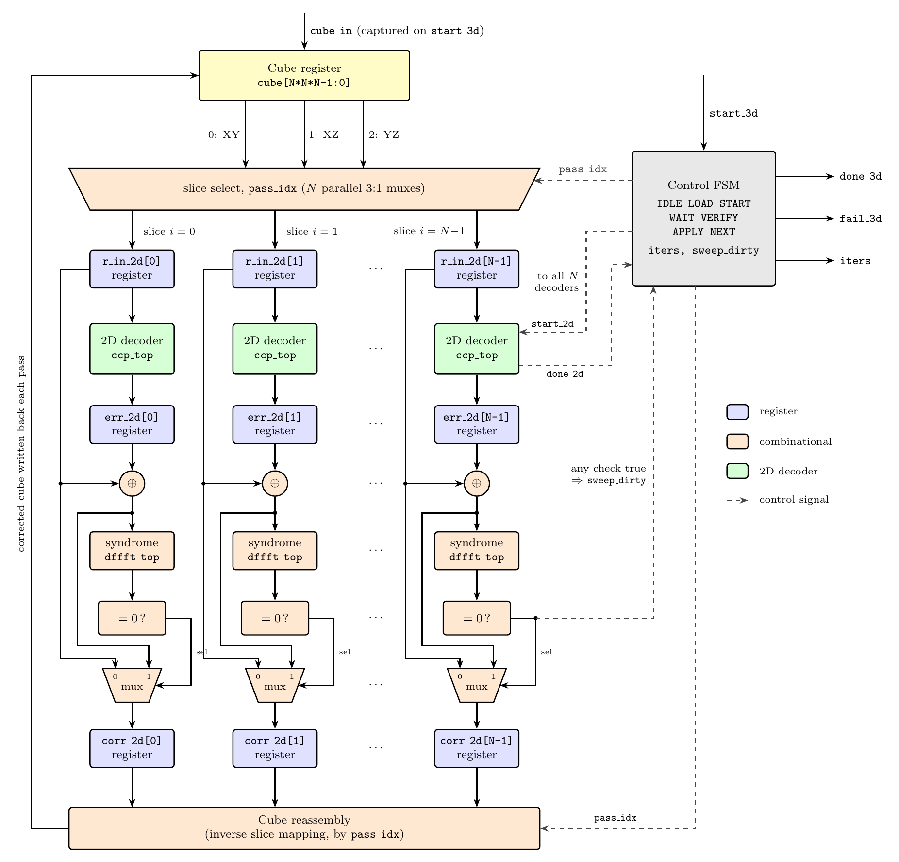

# A Parallel 3D BCH decoder implementation with Slice-Wise 2D BCH corrections

This project extends the pipelined **decoder** for two-dimensional
Bose–Chaudhuri–Hocquenghem (BCH) codes, built on the frequency-domain architecture of

> A. Mondal and S. S. Garani, "Efficient Hardware Architectures for 2-D BCH Codes in the Frequency Domain
> for Two-Dimensional Data Storage Applications," *IEEE Transactions on Magnetics*, vol. 57, no. 5, May 2021.
> [DOI: 10.1109/TMAG.2021.3060807](https://doi.org/10.1109/TMAG.2021.3060807)

into a decoder for **three-dimensional** data. A 15 × 15 × 15 binary cube is treated as a stack of
2D slices, and each slice is decoded with the 2D frequency-domain decoder. The cube is cut along
all three orientations (XY, XZ and YZ), so every bit is covered by one slice in each orientation
and errors that one orientation cannot correct can be resolved by another.

> A full implementation of the 2D BCH decoder that this project builds on can be found at
> [acac2495/2D-BCH-Codes](https://github.com/acac2495/2D-BCH-Codes).

## How it works

1. **Slice.** For the current orientation (`pass_idx` = XY, XZ or YZ), the cube is split into
   N = 15 slices of 15 × 15 bits.
2. **Decode in parallel.** N copies of the 2D decoder (`ccp_top`) run at the same time, one per
   slice. Each decoder computes the 2D syndromes in the frequency domain, finds the row and
   column error-locator polynomials with Berlekamp–Massey, recovers the remaining syndromes by
   recursive extension, and returns an error pattern through the inverse transform.
3. **Verify.** A slice correction is accepted only if the corrected slice has all-zero syndromes
   (`dffft_top` is reused as a syndrome checker). Otherwise the slice is left unchanged, so an
   undecodable slice cannot corrupt the cube.
4. **Write back.** The corrected slices are reassembled into the cube.
5. **Repeat.** The three orientations are applied in turn. A sweep that makes no correction means
   the cube is clean (`done_3d`); if the cube is still changing after `MAX_ITER` sweeps, the decoder
   stops with `fail_3d` set.

The design is parameterized by [`N = 15`, `M = 4` (GF(2⁴)), `T = 2`], and the control logic is a
small FSM around the slice mux, the 2D decoders, and the verification and write-back stages.

## Architecture

  

*Block diagram of the decoder. The cube is cut into N = 15 slices along the orientation selected by
`pass_idx`, and the slices are decoded in parallel by N copies of the 2D decoder. The decoder's error
estimate is applied to a slice only if the corrected slice has zero syndromes. The accepted slices are
then reassembled into the cube. Only lanes 0, 1 and N−1 are drawn. The dashed lines show control signals.*

## Repository structure

| Folder | Contents |
|---|---|
| [`2D_bch_datapath/`](2D_bch_datapath) | The 2D frequency-domain BCH decoder (Verilog), one subfolder per pipeline stage |
| [`3d_datapath/`](3d_datapath) | The 3D top level that wraps N copies of the 2D decoder, plus its testbench |
| [`all_hex_files/`](all_hex_files) | Lookup tables loaded with `$readmemh` (`dfft_*.hex`, `alpha_*.hex`, `poly_*.hex`) |
| [`docs/`](docs) | Architecture diagram (PNG, SVG, TikZ source) |

> **Simulation tip:** the hex files are opened by relative path. Run the simulator from a directory
> that contains them (or copy `all_hex_files/*` next to your simulation), otherwise the tables load
> as zeros or the run fails.

### `3d_datapath/`

| File | Top module | Description |
|---|---|---|
| `[top_3d.v]` | `top_3d` | 3D decoder. Splits the cube into N slices per pass, decodes them with N parallel `ccp_top` instances, applies a slice correction only if it passes the syndrome check, and writes the slices back. Ports: `clk, rst, start_3d, cube_in, done_3d, fail_3d, iters`. |
| `[tb_3d.v]` | `tb_3d` | Testbench. Reads `cube_in.hex`, runs the decoder and prints `iters` and `fail_3d`. |

### `2D_bch_datapath/`

The top module is **`ccp_top`** (`ccp/ccp_top.v`). It takes one N × N slice `r_in` and, a fixed number of
cycles after `start`, raises `done` with the estimated error pattern on `c_out`. Everything else is
instantiated from it: